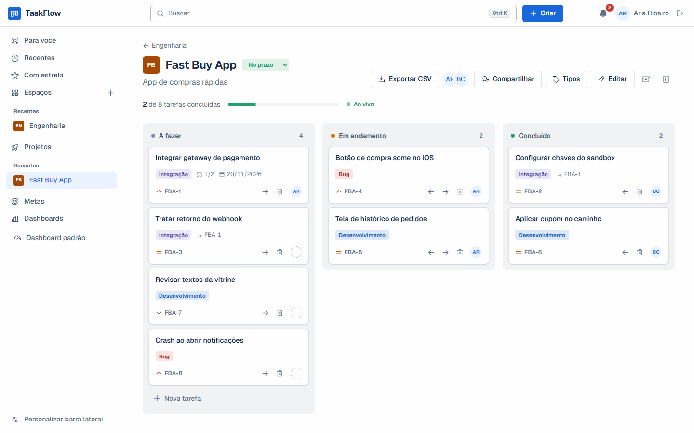
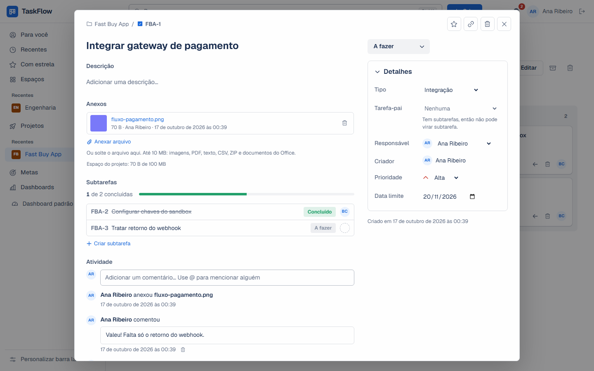
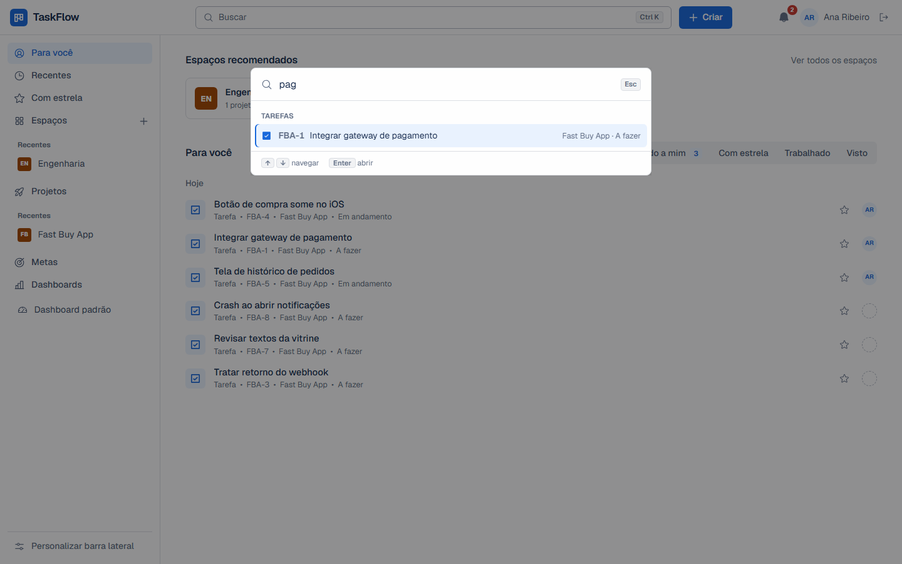
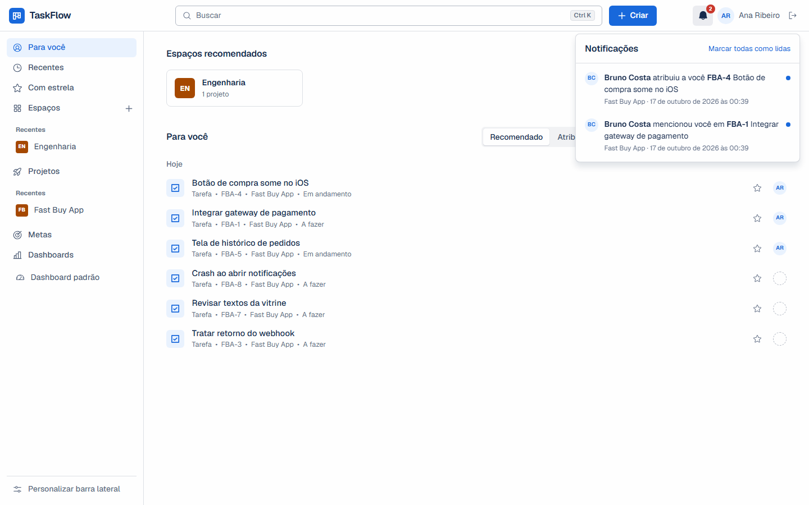
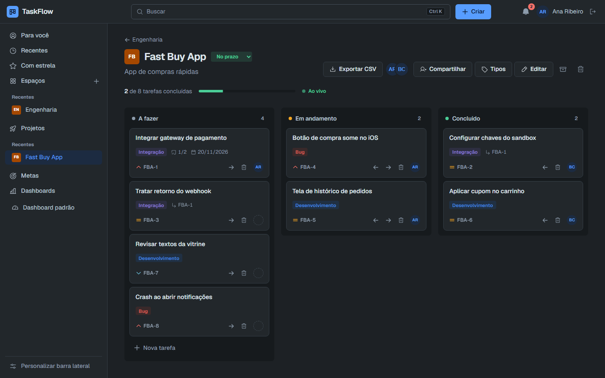
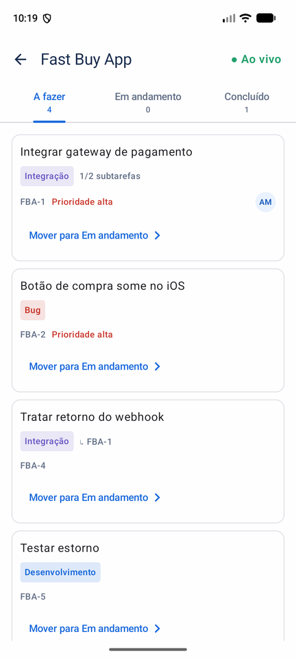
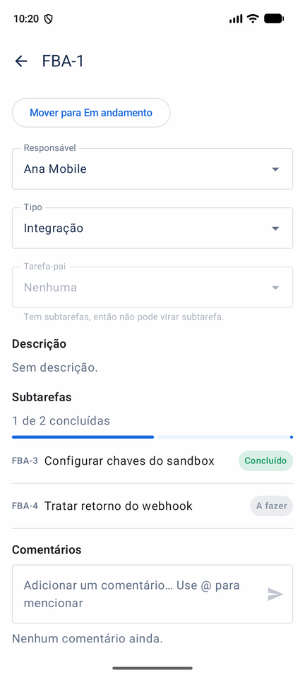
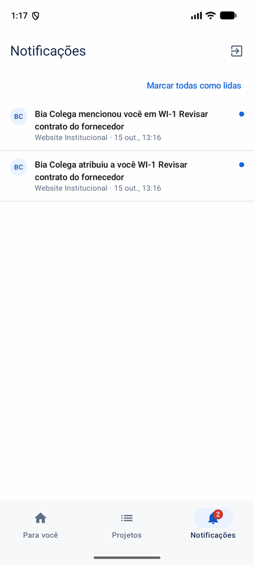
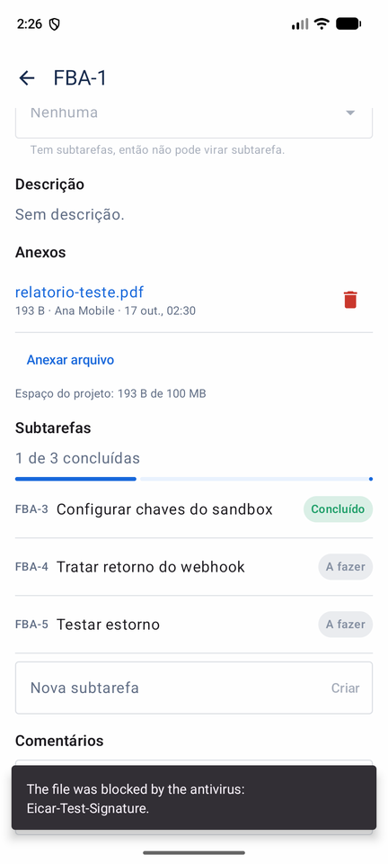
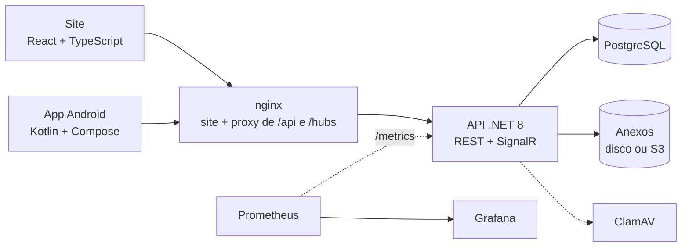

# TaskFlow

[](https://github.com/Alexandregv1080p/TASKFLOW/actions/workflows/ci.yml)


Gestão de projetos e tarefas no estilo do Jira, com quadro kanban colaborativo em tempo real. API em .NET 8 com Clean Architecture, site em React e app Android nativo, todos falando com a mesma API.



## O que ele faz

- **Quadro kanban** com arrastar e soltar, tipos de tarefa por projeto (Bug, Integração... o dono cria quantos quiser), responsável, prioridade, prazo e subtarefas.
- **Tempo real:** o card que alguém move, o comentário que alguém escreve e as notificações aparecem na hora para quem está com a tela aberta, no site e no app.
- **Colaboração:** projetos compartilhados com papéis (dono, membro e visualizador, que só acompanha), comentários com menção `@`, histórico de tudo o que mudou na tarefa.
- **Anexos** com antivírus (ClamAV), cota de espaço por projeto e armazenamento em disco ou S3.
- **Organização:** espaços criados a partir de modelos (Kanban, Scrum, Roadmap...), página "Para você", diretório de projetos, metas, dashboard e busca global com `Ctrl+K`.
- **Dados do usuário:** exportação das tarefas em CSV, pronta para o Excel.
- **Webhooks:** outros sistemas recebem os eventos do projeto (tarefa criada, status, comentário...) por POST assinado, com novas tentativas e histórico de entregas.

## Capturas

| Detalhe da tarefa | Busca global (`Ctrl+K`) |
| --- | --- |
|  |  |
| **Notificações e "Para você"** | **Tema escuro** |
|  |  |

App Android, com o mesmo tempo real:

<p>
  
  
  
  
</p>

## Arquitetura



A API segue Clean Architecture: `Domain` (entidades e regras), `Application` (casos de uso, sem depender de banco nem de framework web), `Infrastructure` (EF Core, armazenamento, antivírus) e `Api` (HTTP e SignalR).

## Destaques técnicos

- **Uma regra de acesso só.** Quem vê e quem altera cada projeto é decidido em um lugar (`ProjectAccess`) e usado por todos os casos de uso. Sem acesso, a API responde 404: não revela que o projeto existe.
- **Tempo real que não vaza dados.** O SignalR só avisa "este projeto mudou"; quem recebe recarrega pela API REST, que já aplica as permissões. Não existe um segundo caminho de leitura para proteger.
- **Anexos tratados como entrada não confiável:** lista de tipos permitidos, tipo decidido pela extensão (não pelo que o navegador declara), caminho em disco gerado pelo servidor, download sempre autenticado e forçado como arquivo, verificação no ClamAV antes de gravar e limpeza dos arquivos ao excluir tarefa ou projeto.
- **Webhooks com outbox:** o evento é gravado na mesma transação da alteração e entregue por um worker em segundo plano, com novas tentativas (espera dobrando), assinatura HMAC no estilo Stripe e `FOR UPDATE SKIP LOCKED` para várias réplicas dividirem a fila. A URL é do usuário, então o envio barra endereços internos no IP resolvido na hora de conectar (SSRF, inclusive DNS rebinding).
- **CSV seguro para planilha:** texto que começa com `=`, `+`, `-` ou `@` sai como texto, não como fórmula (injeção de CSV).
- **Uma interface, duas implementações:** o armazenamento é `IFileStorage` (disco local ou S3), e os mesmos testes de contrato rodam contra as duas.
- **Mesmas regras nos três clientes:** a chave da tarefa (`WEB-12`), as transições de status e a regra de menção são iguais na API, no site e no app, com os mesmos casos de teste.
- **Observabilidade:** logs estruturados em JSON, métricas HTTP e de negócio no Prometheus e dashboard no Grafana, tudo provisionado como código.

## Testes

| Onde | O que | Quantos |
| --- | --- | --- |
| Backend | Unitários (domínio) e integração contra PostgreSQL real, com a API em memória | 155+ |
| Android | Comunicação com a API (JUnit + MockWebServer) e regras compartilhadas com o site | 20 |
| Ponta a ponta | Playwright contra a stack completa em containers, incluindo duas pessoas em tempo real | 8 |

O CI (GitHub Actions) roda tudo isso em cada pull request: build e testes do backend (com um S3 de verdade para os testes de armazenamento), lint e build do site, testes, lint e APK do Android, e a stack inteira em Docker com smoke test e os testes de ponta a ponta. Na `main`, publica as imagens no GitHub Container Registry.

## Estrutura

```text
backend/
├── TaskFlow.Api              # Controllers, SignalR, middleware, configuração HTTP
├── TaskFlow.Application      # Casos de uso, DTOs, interfaces
├── TaskFlow.Domain           # Entidades e regras de negócio
└── TaskFlow.Infrastructure   # EF Core/PostgreSQL, armazenamento (disco/S3), antivírus
frontend/taskflow-web         # Site: React + TypeScript + Vite
mobile/taskflow-android       # App Android: Kotlin + Jetpack Compose
e2e/                          # Testes de ponta a ponta (Playwright)
tests/
├── TaskFlow.UnitTests        # Regras de domínio
└── TaskFlow.IntegrationTests # Persistência, casos de uso, API, armazenamento e antivírus
docker/                       # Dockerfiles, nginx, Prometheus e Grafana
```

## Rodando com Docker (aplicação completa)

Pré-requisito: Docker.

```bash
cp .env.example .env
```

Edite o `.env` e defina `JWT_SECRET` (mínimo 32 caracteres, ex.: `openssl rand -base64 48`). Depois:

```bash
docker compose up -d --build
```

* Site: http://localhost:3000 (crie uma conta em "Criar conta")
* Swagger: http://localhost:8080/swagger
* Health: http://localhost:8080/health

Portas ocupadas? Ajuste `WEB_PORT` / `API_PORT` no `.env`.

### Opcionais

Cada um sobe com um perfil do compose:

| Perfil | O que liga | Como |
| --- | --- | --- |
| `observability` | Prometheus e Grafana (dashboard "TaskFlow" já provisionado) | `docker compose --profile observability up -d` |
| `s3` | Anexos num S3 local (SeaweedFS) | `STORAGE_PROVIDER=S3` e `S3_SECRET_KEY` no `.env`, depois `docker compose --profile s3 up -d` |
| `antivirus` | ClamAV verificando cada anexo (~1 GB de memória) | `ANTIVIRUS_HOST=clamav` no `.env`, depois `docker compose --profile antivirus up -d` |

* Grafana: http://localhost:3001 (usuário `admin`, senha `GRAFANA_PASSWORD` do `.env`)
* Prometheus: http://localhost:9090 (alvos em Status > Targets, regras em Alerts)
* Logs estruturados em JSON: `docker logs taskflow-api`

### Recebendo webhooks

No projeto, botão **Webhooks** (só o dono). Para ver chegando sem escrever código, use uma URL de teste pública (como a do webhook.site) e clique em "Enviar teste". Endereços internos (localhost, redes privadas) são recusados fora do ambiente de desenvolvimento.

Cada envio traz `X-TaskFlow-Event`, `X-TaskFlow-Delivery` (id único, para ignorar repetidas) e `X-TaskFlow-Signature: t=<unix>,v1=<hex>`. Para conferir, em Node:

```js
import crypto from 'node:crypto'

// rawBody: o corpo exatamente como chegou (string), antes de qualquer JSON.parse.
function isFromTaskFlow(rawBody, header, secret) {
  const { t, v1 } = Object.fromEntries(header.split(',').map((part) => part.split('=')))
  if (Math.abs(Date.now() / 1000 - Number(t)) > 300) return false // mais de 5 min: possível reenvio
  const expected = crypto.createHmac('sha256', secret).update(`${t}.${rawBody}`).digest('hex')
  return v1?.length === expected.length && crypto.timingSafeEqual(Buffer.from(expected), Buffer.from(v1))
}
```

Responda 2xx rápido; qualquer outra resposta (ou mais de 10 s) gera nova tentativa.

## Rodando para desenvolvimento

Pré-requisitos: .NET 8 SDK, Node.js 20+ e Docker.

```bash
docker compose up -d postgres
dotnet run --project backend/TaskFlow.Api
```

Em outro terminal:

```bash
cd frontend/taskflow-web
npm install
npm run dev
```

Em Development a API aplica as migrations automaticamente e usa o segredo JWT de desenvolvimento do `appsettings.Development.json`.

* Site: http://localhost:5173
* Swagger: http://localhost:5033/swagger
* PostgreSQL: `localhost:5436` (db/usuário/senha: `taskflow`, apenas para desenvolvimento).

## App Android

Com a stack no ar e um emulador aberto:

```bash
cd mobile/taskflow-android
./gradlew installDebug -Ptaskflow.apiUrl=http://10.0.2.2:3000/
```

`10.0.2.2` é o localhost da máquina visto pelo emulador; use a porta do site (`WEB_PORT`, padrão 3000), porque o nginx repassa `/api` e `/hubs`. Em aparelho físico na mesma rede, troque pelo IP da máquina. Testes e lint: `./gradlew testDebugUnitTest lintDebug`. O CI gera o APK de debug como artefato.

## Rodando os testes

```bash
dotnet test backend/TaskFlow.sln
```

Os testes de integração usam o banco `taskflow_tests` no mesmo PostgreSQL (recriado a cada execução). Os testes contra S3 e ClamAV de verdade rodam quando `TASKFLOW_TEST_S3_URL` / `TASKFLOW_TEST_CLAMAV_HOST` estão definidas; sem elas, aparecem como pulados.

Site (checagem de tipos, build e lint):

```bash
cd frontend/taskflow-web
npm run build
npm run lint
```

Ponta a ponta (Playwright), com a stack no ar. Cada teste cria os próprios usuários:

```bash
cd e2e
npm ci
npx playwright install chromium
E2E_BASE_URL=http://localhost:3000 npx playwright test
```

## Documentação

A especificação completa, fase a fase, com as decisões técnicas e os limites conhecidos de cada funcionalidade, está em [TASKFLOW.md](TASKFLOW.md).
